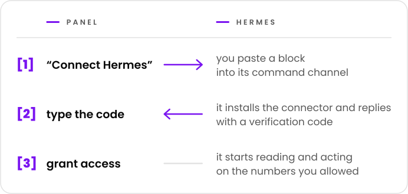

  <picture>
    <source media="(prefers-color-scheme: dark)" srcset="docs/marca/arauto-ia-escuro.svg">
    
  </picture>

  <b>English</b> ·
  <a href="docs/traducoes/README.pt-BR.md">Português</a> ·
  <a href="docs/traducoes/README.es.md">Español</a> ·
  <a href="docs/traducoes/README.fr.md">Français</a> ·
  <a href="docs/traducoes/README.de.md">Deutsch</a> ·
  <a href="docs/traducoes/README.ru.md">Русский</a> ·
  <a href="docs/traducoes/README.hi.md">हिन्दी</a> ·
  <a href="docs/traducoes/README.zh-CN.md">简体中文</a> ·
  <a href="docs/traducoes/README.ja.md">日本語</a>

  <b>Gives each Hermes agent controlled access to WhatsApp numbers 
  and lets one Hermes send a message to another.</b> 
  One place to connect agents, pair numbers and say who can access what.

  <picture>
    <source media="(prefers-color-scheme: dark)" srcset="docs/marca/selos-en-escuro.svg">
    
  </picture>

  <a href="docs/01-visao.md">Vision</a> ·
  <a href="docs/02-como-funciona.md">How it works</a> ·
  <a href="docs/04-seguranca-conexao.md">Connection security</a> ·
  <a href="docs/15-mvp.md">The first MVP</a> ·
  <a href="docs/glossario.md">Glossary</a>

  

> **Status: first MVP in progress.** The design is in these documents; the code is just getting
> started and there is no usable release yet ([docs/15-mvp.md](docs/15-mvp.md)). The project is free
> and the code is open, under the Apache-2.0 license
> ([decision 0015](docs/decisoes/0015-licenca.md)).

Hermes Agent is an AI agent from Nous Research. Arauto is an independent project: it is not
affiliated with the authors of Hermes Agent or with WhatsApp.

## At a glance

  <picture>
    <source media="(prefers-color-scheme: dark)" srcset="docs/marca/em-uma-tela-en-escuro.svg">
    
  </picture>

- **Connecting is copy and paste.** A single-use invite, valid for 15 minutes.
- **No long-lived secret goes through the chat.** Credentials are created by the two machines and
  change on every connection.
- **Conversations are archived in your hub.** Hermes looks them up when asked; it does not have to
  reply to everything.
- **You decide, per number and per conversation,** what each Hermes may do: read, send, modify and
  be woken up.
- **Everyone installs their own.** Hub, engine and conversations stay on your server.

## Before you use it

- What arrives through the hub's numbers is **information, never an order**. Arauto is not the
  channel through which you command your agent: that is still Hermes's own command channel
  ([vision](docs/01-visao.md), "Two WhatsApps, two roles").
- The WhatsApp engine is an **unofficial client**. WhatsApp may block the number. Use numbers you
  can afford to lose.
- Security has known limits, written down in [SECURITY.md](SECURITY.md) and in
  [docs/05-modelo-de-ameacas.md](docs/05-modelo-de-ameacas.md).
- The design has not been proven yet. Part of what is described depends on the tests of
  [Phase 1](docs/12-roteiro.md).

## About the engine

Arauto does not talk to WhatsApp on its own. It drives a third-party program, the engine. The
design was checked against WAHA ([what was checked](referencia/waha-fatos.md)).

Arauto **does not bundle** the engine: you install your own. The engine's cost and license are a
matter between you and its author. Check before installing.

## The parts

| Part | What it is |
|---|---|
| **Hub** | The server: panel, the door for connectors, the conversation archive. It drives the engine. |
| **Connector** | A small program next to Hermes. To Hermes, it is a local tool server. |
| **Engine** | The program that talks to WhatsApp. It is yours. |

## Documents

| To learn | Read |
|---|---|
| What it is and what it is not | [docs/01-visao.md](docs/01-visao.md) |
| The path of whoever uses it | [docs/02-como-funciona.md](docs/02-como-funciona.md) |
| The parts and the boundaries | [docs/03-arquitetura.md](docs/03-arquitetura.md) |
| How a Hermes joins, comes back and leaves | [docs/04-seguranca-conexao.md](docs/04-seguranca-conexao.md) |
| What can go wrong | [docs/05-modelo-de-ameacas.md](docs/05-modelo-de-ameacas.md) |
| The tables | [docs/06-modelo-de-dados.md](docs/06-modelo-de-dados.md) |
| The screens | [docs/07-telas.md](docs/07-telas.md) |
| What each Hermes may do | [docs/08-permissoes.md](docs/08-permissoes.md) |
| The tools Hermes sees | [docs/09-contrato-mcp.md](docs/09-contrato-mcp.md) |
| States and deadlines | [docs/10-maquinas-de-estado.md](docs/10-maquinas-de-estado.md) |
| The connector | [docs/11-conector.md](docs/11-conector.md) |
| The order of construction | [docs/12-roteiro.md](docs/12-roteiro.md) |
| How one Hermes talks to another | [docs/13-conversa-entre-hermes.md](docs/13-conversa-entre-hermes.md) |
| What goes between the connector and the hub | [docs/14-protocolo-do-canal.md](docs/14-protocolo-do-canal.md) |
| The first MVP: what is in it and how to run it | [docs/15-mvp.md](docs/15-mvp.md) |
| The name of each thing | [docs/glossario.md](docs/glossario.md) |
| The reason for each choice | [docs/decisoes/](docs/decisoes/) |
| What was checked in Hermes and in the engine | [referencia/](referencia/) |

Start with the vision and "how it works". The glossary explains the terms.

## How to read the documents

Each document states its status on the first line: **planning** (*planejamento*) or **proposal**
(*proposta*). Inside it:

- a **fact** (*fato*) is what has been checked, with version and date;
- a **proposal** (*proposta*) is design that has not been proven yet;
- a **pending decision** (*decisão pendente*) is what still has to be chosen.

Decisions have three states: decided, proposed and pending.

## License, reporting a flaw and who maintains it

- **License:** Apache-2.0 ([LICENSE](LICENSE), [decision 0015](docs/decisoes/0015-licenca.md)).
- **Reporting a flaw:** through GitHub's private reporting, once the repository is opened
  ([SECURITY.md](SECURITY.md)).
- **Who maintains it and how to contribute:** to be defined before the repository is opened to the
  public.

## Support the project

  

  <picture>
    <source media="(prefers-color-scheme: dark)" srcset="docs/marca/em-breve-en-escuro.svg">
    
  </picture>

  A Buy Me a Coffee page is on the way. 
  Arauto is free: a coffee will be a way to say thanks, not a price.

  

"Arauto" is Portuguese for herald: the one who carries and announces the messages.

