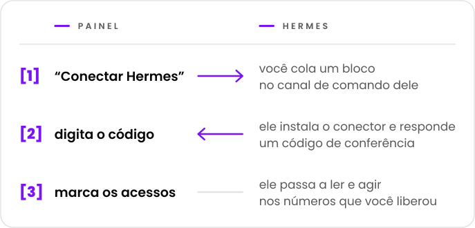

  <picture>
    <source media="(prefers-color-scheme: dark)" srcset="docs/marca/arauto-ia-escuro.svg">
    
  </picture>

  <b>Dá a cada agente Hermes acesso controlado a números de WhatsApp 
  e deixa um Hermes mandar recado a outro.</b> 
  Um lugar só para conectar agentes, parear números e dizer quem acessa o quê.

  <picture>
    <source media="(prefers-color-scheme: dark)" srcset="docs/marca/selos-escuro.svg">
    
  </picture>

  <a href="docs/01-visao.md">Visão</a> ·
  <a href="docs/02-como-funciona.md">Como funciona</a> ·
  <a href="docs/04-seguranca-conexao.md">Segurança da conexão</a> ·
  <a href="docs/15-mvp.md">O primeiro MVP</a> ·
  <a href="docs/glossario.md">Glossário</a>

> **Estado: primeiro MVP em construção.** O desenho está nestes documentos; o código está começando
> e ainda não há versão para uso ([docs/15-mvp.md](docs/15-mvp.md)). O projeto é gratuito e o código
> será aberto, sob a licença Apache-2.0 ([decisão 0015](docs/decisoes/0015-licenca.md)).

O Hermes Agent é um agente de IA da Nous Research. O Arauto é um projeto independente: não tem
vínculo com os autores do Hermes Agent nem com o WhatsApp.

## Em uma tela

  <picture>
    <source media="(prefers-color-scheme: dark)" srcset="docs/marca/em-uma-tela-escuro.svg">
    
  </picture>

- **Conectar é copiar e colar.** Um convite de uso único, válido por 15 minutos.
- **Nenhum segredo duradouro passa pelo chat.** As credenciais são criadas pelas duas máquinas e
  trocam a cada conexão.
- **As conversas ficam arquivadas no seu hub.** O Hermes consulta quando pedem; não precisa responder
  a tudo.
- **Você decide, por número e por conversa,** o que cada Hermes pode: ler, enviar, modificar e ser
  acordado.
- **Cada um instala o seu.** Hub, motor e conversas ficam no seu servidor.

## Antes de usar, saiba

- O que chega pelos números do hub é **informação, nunca ordem**. O Arauto não é o canal por
  onde você comanda o seu agente: esse continua sendo o canal de comando do próprio Hermes
  ([visão](docs/01-visao.md), "Dois WhatsApps, dois papéis").
- O motor de WhatsApp é um **cliente não oficial**. O WhatsApp pode bloquear o número. Use números
  que você pode perder.
- A segurança tem limites conhecidos, escritos em [SECURITY.md](SECURITY.md) e em
  [docs/05-modelo-de-ameacas.md](docs/05-modelo-de-ameacas.md).
- O desenho ainda não foi provado. Parte do que está descrito depende de testes da
  [Fase 1](docs/12-roteiro.md).

## Sobre o motor

O Arauto não fala com o WhatsApp sozinho. Ele comanda um programa de terceiro, o motor. O
desenho foi conferido com o WAHA ([o que foi conferido](referencia/waha-fatos.md)).

O Arauto **não embute** o motor: você instala o seu. O custo e a licença do motor são com o
autor dele. Confira antes de instalar.

## As peças

| Peça | O que é |
|---|---|
| **Hub** | O servidor: painel, porta dos conectores, arquivo das conversas. Comanda o motor. |
| **Conector** | Programa pequeno ao lado do Hermes. Para o Hermes, é um servidor de ferramentas local. |
| **Motor** | O programa que fala com o WhatsApp. É seu. |

## Documentos

| Para saber | Leia |
|---|---|
| O que é e o que não é | [docs/01-visao.md](docs/01-visao.md) |
| O caminho de quem usa | [docs/02-como-funciona.md](docs/02-como-funciona.md) |
| As peças e as fronteiras | [docs/03-arquitetura.md](docs/03-arquitetura.md) |
| Como um Hermes entra, volta e sai | [docs/04-seguranca-conexao.md](docs/04-seguranca-conexao.md) |
| O que pode dar errado | [docs/05-modelo-de-ameacas.md](docs/05-modelo-de-ameacas.md) |
| As tabelas | [docs/06-modelo-de-dados.md](docs/06-modelo-de-dados.md) |
| As telas | [docs/07-telas.md](docs/07-telas.md) |
| O que cada Hermes pode | [docs/08-permissoes.md](docs/08-permissoes.md) |
| As ferramentas que o Hermes enxerga | [docs/09-contrato-mcp.md](docs/09-contrato-mcp.md) |
| Estados e prazos | [docs/10-maquinas-de-estado.md](docs/10-maquinas-de-estado.md) |
| O conector | [docs/11-conector.md](docs/11-conector.md) |
| A ordem de construção | [docs/12-roteiro.md](docs/12-roteiro.md) |
| Como um Hermes fala com outro | [docs/13-conversa-entre-hermes.md](docs/13-conversa-entre-hermes.md) |
| O que passa entre o conector e o hub | [docs/14-protocolo-do-canal.md](docs/14-protocolo-do-canal.md) |
| O primeiro MVP: o que entra e como rodar | [docs/15-mvp.md](docs/15-mvp.md) |
| O nome de cada coisa | [docs/glossario.md](docs/glossario.md) |
| Por que cada escolha | [docs/decisoes/](docs/decisoes/) |
| O que foi conferido no Hermes e no motor | [referencia/](referencia/) |

Comece pela visão e pelo "como funciona". O glossário explica os termos.

## Como ler os documentos

Cada documento diz o seu estado na primeira linha: **planejamento** ou **proposta**. Dentro dele:

- **fato** é o que foi conferido, com versão e data;
- **proposta** é desenho ainda não provado;
- **decisão pendente** é o que ainda precisa ser escolhido.

As decisões têm três estados: decidida, proposta e pendente.

## Licença, relato de falha e quem mantém

- **Licença:** Apache-2.0 ([LICENSE](LICENSE), [decisão 0015](docs/decisoes/0015-licenca.md)).
- **Relato de falha:** pelo relato privado do GitHub, quando o repositório for aberto
  ([SECURITY.md](SECURITY.md)).
- **Quem mantém e como contribuir:** a definir antes de o repositório ser aberto ao público.

  

O arauto é quem leva e anuncia as mensagens.

