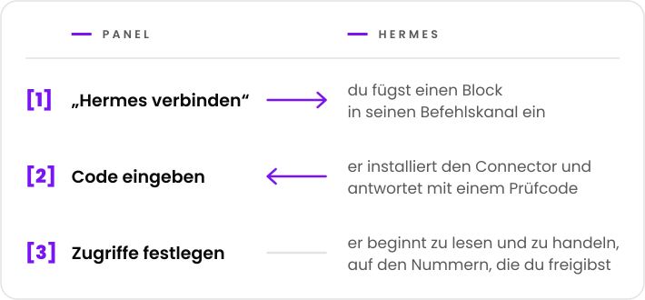

  <picture>
    <source media="(prefers-color-scheme: dark)" srcset="../marca/arauto-ia-escuro.svg">
    
  </picture>

  <a href="../../README.md">English</a> ·
  <a href="README.pt-BR.md">Português</a> ·
  <a href="README.es.md">Español</a> ·
  <a href="README.fr.md">Français</a> ·
  <b>Deutsch</b> ·
  <a href="README.ru.md">Русский</a> ·
  <a href="README.hi.md">हिन्दी</a> ·
  <a href="README.zh-CN.md">简体中文</a> ·
  <a href="README.ja.md">日本語</a>

  <b>Gibt jedem Hermes-Agenten kontrollierten Zugriff auf WhatsApp-Nummern 
  und lässt einen Hermes einem anderen eine Nachricht schicken.</b> 
  Ein einziger Ort, um Agenten zu verbinden, Nummern zu koppeln und festzulegen, wer worauf zugreift.

  <picture>
    <source media="(prefers-color-scheme: dark)" srcset="../marca/selos-de-escuro.svg">
    
  </picture>

  <a href="../01-visao.md">Vision</a> ·
  <a href="../02-como-funciona.md">So funktioniert es</a> ·
  <a href="../04-seguranca-conexao.md">Sicherheit der Verbindung</a> ·
  <a href="../15-mvp.md">Das erste MVP</a> ·
  <a href="../glossario.md">Glossar</a>

  

> **Stand: erstes MVP im Aufbau.** Der Entwurf steht in diesen Dokumenten; der Code steht am
> Anfang, und es gibt noch keine nutzbare Version ([docs/15-mvp.md](../15-mvp.md)). Das Projekt ist
> kostenlos, und der Code wird unter der Apache-2.0-Lizenz offengelegt
> ([Entscheidung 0015](../decisoes/0015-licenca.md)).

Hermes Agent ist ein KI-Agent von Nous Research. Arauto ist ein unabhängiges Projekt: Es steht in
keiner Verbindung zu den Autoren von Hermes Agent oder zu WhatsApp.

Die von dieser Seite aus verlinkten Dokumente sind auf Englisch verfasst.

## Auf einen Blick

  <picture>
    <source media="(prefers-color-scheme: dark)" srcset="../marca/em-uma-tela-de-escuro.svg">
    
  </picture>

- **Verbinden heißt kopieren und einfügen.** Eine Einladung zur einmaligen Verwendung, 15 Minuten
  gültig.
- **Kein dauerhaftes Geheimnis läuft über den Chat.** Die Zugangsdaten werden von den beiden
  Maschinen erzeugt und wechseln bei jeder Verbindung.
- **Die Unterhaltungen werden in deinem Hub archiviert.** Hermes schlägt nach, wenn er gefragt
  wird; er muss nicht auf alles antworten.
- **Du entscheidest, pro Nummer und pro Unterhaltung,** was jeder Hermes darf: lesen, senden,
  ändern und geweckt werden.
- **Jeder installiert sein eigenes.** Hub, Engine und Unterhaltungen bleiben auf deinem Server.

## Bevor du es benutzt

- Was über die Nummern des Hubs ankommt, ist **Information, niemals ein Befehl**. Arauto ist nicht
  der Kanal, über den du deinem Agenten Befehle gibst: Das bleibt der Befehlskanal von Hermes
  selbst ([Vision](../01-visao.md), „Two WhatsApps, two roles“).
- Die WhatsApp-Engine ist ein **inoffizieller Client**. WhatsApp kann die Nummer sperren. Nimm
  Nummern, deren Verlust du verschmerzen kannst.
- Die Sicherheit hat bekannte Grenzen, beschrieben in [SECURITY.md](../../SECURITY.md) und in
  [docs/05-modelo-de-ameacas.md](../05-modelo-de-ameacas.md).
- Der Entwurf ist noch nicht erprobt. Ein Teil des Beschriebenen hängt von den Tests der
  [Phase 1](../12-roteiro.md) ab.

## Über die Engine

Arauto spricht nicht selbst mit WhatsApp. Es steuert ein Programm eines Dritten, die Engine. Der
Entwurf wurde mit WAHA geprüft ([was geprüft wurde](../../referencia/waha-fatos.md)).

Arauto **liefert die Engine nicht mit**: Du installierst deine eigene. Kosten und Lizenz der
Engine sind Sache zwischen dir und ihrem Autor. Prüfe das vor der Installation.

## Die Teile

| Teil | Was es ist |
|---|---|
| **Hub** | Der Server: das Panel, die Tür für die Connectoren und das Archiv der Unterhaltungen. Er steuert die Engine. |
| **Connector** | Ein kleines Programm neben Hermes. Für Hermes ist es ein lokaler Tool-Server. |
| **Engine** | Das Programm, das mit WhatsApp spricht. Es gehört dir. |

## Dokumente

| Um zu erfahren | Lies |
|---|---|
| Was es ist und was nicht | [docs/01-visao.md](../01-visao.md) |
| Den Weg der Nutzer | [docs/02-como-funciona.md](../02-como-funciona.md) |
| Die Teile und die Grenzen | [docs/03-arquitetura.md](../03-arquitetura.md) |
| Wie ein Hermes beitritt, zurückkommt und geht | [docs/04-seguranca-conexao.md](../04-seguranca-conexao.md) |
| Was schiefgehen kann | [docs/05-modelo-de-ameacas.md](../05-modelo-de-ameacas.md) |
| Die Tabellen | [docs/06-modelo-de-dados.md](../06-modelo-de-dados.md) |
| Die Bildschirme | [docs/07-telas.md](../07-telas.md) |
| Was jeder Hermes darf | [docs/08-permissoes.md](../08-permissoes.md) |
| Die Tools, die Hermes sieht | [docs/09-contrato-mcp.md](../09-contrato-mcp.md) |
| Zustände und Fristen | [docs/10-maquinas-de-estado.md](../10-maquinas-de-estado.md) |
| Den Connector | [docs/11-conector.md](../11-conector.md) |
| Die Reihenfolge des Aufbaus | [docs/12-roteiro.md](../12-roteiro.md) |
| Wie ein Hermes mit einem anderen spricht | [docs/13-conversa-entre-hermes.md](../13-conversa-entre-hermes.md) |
| Was zwischen Connector und Hub läuft | [docs/14-protocolo-do-canal.md](../14-protocolo-do-canal.md) |
| Das erste MVP: was dazugehört und wie man es startet | [docs/15-mvp.md](../15-mvp.md) |
| Den Namen jeder Sache | [docs/glossario.md](../glossario.md) |
| Den Grund für jede Entscheidung | [docs/decisoes/](../decisoes/) |
| Was an Hermes und an der Engine geprüft wurde | [referencia/](../../referencia/) |

Beginne mit der Vision und mit „So funktioniert es“. Das Glossar erklärt die Begriffe.

## Wie man die Dokumente liest

Jedes Dokument nennt seinen Stand in der ersten Zeile: **Planung** (*planejamento*) oder
**Vorschlag** (*proposta*). Darin gilt:

- eine **Tatsache** (*fato*) ist, was geprüft wurde, mit Version und Datum;
- ein **Vorschlag** (*proposta*) ist ein noch nicht erprobter Entwurf;
- eine **offene Entscheidung** (*decisão pendente*) ist, was noch gewählt werden muss.

Entscheidungen haben drei Zustände: entschieden, vorgeschlagen und offen.

## Lizenz, Meldung von Schwachstellen und Betreuung

- **Lizenz:** Apache-2.0 ([LICENSE](../../LICENSE),
  [Entscheidung 0015](../decisoes/0015-licenca.md)).
- **Meldung von Schwachstellen:** über die private Meldung von GitHub, sobald das Repository
  geöffnet ist ([SECURITY.md](../../SECURITY.md)).
- **Wer das Projekt betreut und wie man beiträgt:** wird festgelegt, bevor das Repository
  öffentlich wird.

## Das Projekt unterstützen

  

  <picture>
    <source media="(prefers-color-scheme: dark)" srcset="../marca/em-breve-de-escuro.svg">
    
  </picture>

  Eine Seite bei Buy Me a Coffee ist in Vorbereitung. 
  Arauto ist kostenlos: Der Kaffee wird ein Dankeschön sein, kein Preis.

  

„Arauto“ ist Portugiesisch für Herold: der, der die Nachrichten überbringt und verkündet.

