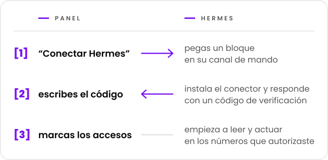

  <picture>
    <source media="(prefers-color-scheme: dark)" srcset="../marca/arauto-ia-escuro.svg">
    
  </picture>

  <a href="../../README.md">English</a> ·
  <a href="README.pt-BR.md">Português</a> ·
  <b>Español</b> ·
  <a href="README.fr.md">Français</a> ·
  <a href="README.de.md">Deutsch</a> ·
  <a href="README.zh-CN.md">简体中文</a> ·
  <a href="README.ja.md">日本語</a>

  <b>Da a cada agente Hermes acceso controlado a números de WhatsApp 
  y permite que un Hermes le envíe un mensaje a otro.</b> 
  Un solo lugar para conectar agentes, vincular números y decir quién accede a qué.

  <picture>
    <source media="(prefers-color-scheme: dark)" srcset="../marca/selos-es-escuro.svg">
    
  </picture>

  <a href="../01-visao.md">Visión</a> ·
  <a href="../02-como-funciona.md">Cómo funciona</a> ·
  <a href="../04-seguranca-conexao.md">Seguridad de la conexión</a> ·
  <a href="../15-mvp.md">El primer MVP</a> ·
  <a href="../glossario.md">Glosario</a>

  

> **Estado: primer MVP en construcción.** El diseño está en estos documentos; el código está
> empezando y todavía no hay una versión para usar ([docs/15-mvp.md](../15-mvp.md)). El proyecto es
> gratuito y el código será abierto, bajo la licencia Apache-2.0
> ([decisión 0015](../decisoes/0015-licenca.md)).

Hermes Agent es un agente de IA de Nous Research. Arauto es un proyecto independiente: no tiene
vínculo con los autores de Hermes Agent ni con WhatsApp.

Los documentos enlazados desde esta página están escritos en portugués.

## En una pantalla

  <picture>
    <source media="(prefers-color-scheme: dark)" srcset="../marca/em-uma-tela-es-escuro.svg">
    
  </picture>

- **Conectar es copiar y pegar.** Una invitación de un solo uso, válida durante 15 minutos.
- **Ningún secreto duradero pasa por el chat.** Las credenciales las crean las dos máquinas y
  cambian en cada conexión.
- **Las conversaciones quedan archivadas en tu hub.** Hermes las consulta cuando se lo piden; no
  tiene que responder a todo.
- **Tú decides, por número y por conversación,** lo que puede hacer cada Hermes: leer, enviar,
  modificar y ser despertado.
- **Cada quien instala el suyo.** El hub, el motor y las conversaciones se quedan en tu servidor.

## Antes de usarlo

- Lo que llega por los números del hub es **información, nunca una orden**. Arauto no es el canal
  por el que le das órdenes a tu agente: ese sigue siendo el canal de mando del propio Hermes
  ([visión](../01-visao.md), "Dois WhatsApps, dois papéis").
- El motor de WhatsApp es un **cliente no oficial**. WhatsApp puede bloquear el número. Usa
  números que puedas perder.
- La seguridad tiene límites conocidos, escritos en [SECURITY.md](../../SECURITY.md) y en
  [docs/05-modelo-de-ameacas.md](../05-modelo-de-ameacas.md).
- El diseño todavía no ha sido probado. Parte de lo descrito depende de las pruebas de la
  [Fase 1](../12-roteiro.md).

## Sobre el motor

Arauto no habla con WhatsApp por sí solo. Controla un programa de terceros, el motor. El diseño se
comprobó con WAHA ([lo que se comprobó](../../referencia/waha-fatos.md)).

Arauto **no incluye** el motor: tú instalas el tuyo. El costo y la licencia del motor son asunto
entre tú y su autor. Revísalos antes de instalar.

## Las piezas

| Pieza | Qué es |
|---|---|
| **Hub** | El servidor: el panel, la puerta de los conectores y el archivo de las conversaciones. Controla el motor. |
| **Conector** | Un programa pequeño junto a Hermes. Para Hermes, es un servidor de herramientas local. |
| **Motor** | El programa que habla con WhatsApp. Es tuyo. |

## Documentos

| Para saber | Lee |
|---|---|
| Qué es y qué no es | [docs/01-visao.md](../01-visao.md) |
| El camino de quien lo usa | [docs/02-como-funciona.md](../02-como-funciona.md) |
| Las piezas y las fronteras | [docs/03-arquitetura.md](../03-arquitetura.md) |
| Cómo un Hermes entra, vuelve y sale | [docs/04-seguranca-conexao.md](../04-seguranca-conexao.md) |
| Lo que puede salir mal | [docs/05-modelo-de-ameacas.md](../05-modelo-de-ameacas.md) |
| Las tablas | [docs/06-modelo-de-dados.md](../06-modelo-de-dados.md) |
| Las pantallas | [docs/07-telas.md](../07-telas.md) |
| Lo que puede hacer cada Hermes | [docs/08-permissoes.md](../08-permissoes.md) |
| Las herramientas que ve Hermes | [docs/09-contrato-mcp.md](../09-contrato-mcp.md) |
| Estados y plazos | [docs/10-maquinas-de-estado.md](../10-maquinas-de-estado.md) |
| El conector | [docs/11-conector.md](../11-conector.md) |
| El orden de construcción | [docs/12-roteiro.md](../12-roteiro.md) |
| Cómo un Hermes habla con otro | [docs/13-conversa-entre-hermes.md](../13-conversa-entre-hermes.md) |
| Lo que pasa entre el conector y el hub | [docs/14-protocolo-do-canal.md](../14-protocolo-do-canal.md) |
| El primer MVP: qué incluye y cómo ejecutarlo | [docs/15-mvp.md](../15-mvp.md) |
| El nombre de cada cosa | [docs/glossario.md](../glossario.md) |
| El porqué de cada elección | [docs/decisoes/](../decisoes/) |
| Lo que se comprobó en Hermes y en el motor | [referencia/](../../referencia/) |

Empieza por la visión y por "cómo funciona". El glosario explica los términos.

## Cómo leer los documentos

Cada documento indica su estado en la primera línea: **planificación** (*planejamento*) o
**propuesta** (*proposta*). Dentro de él:

- un **hecho** (*fato*) es lo que se comprobó, con versión y fecha;
- una **propuesta** (*proposta*) es diseño todavía no probado;
- una **decisión pendiente** (*decisão pendente*) es lo que aún hay que elegir.

Las decisiones tienen tres estados: decidida, propuesta y pendiente.

## Licencia, aviso de fallos y quién lo mantiene

- **Licencia:** Apache-2.0 ([LICENSE](../../LICENSE), [decisión 0015](../decisoes/0015-licenca.md)).
- **Aviso de fallos:** por el aviso privado de GitHub, cuando se abra el repositorio
  ([SECURITY.md](../../SECURITY.md)).
- **Quién lo mantiene y cómo contribuir:** por definir antes de abrir el repositorio al público.

  

"Arauto" significa heraldo en portugués: el que lleva y anuncia los mensajes.

