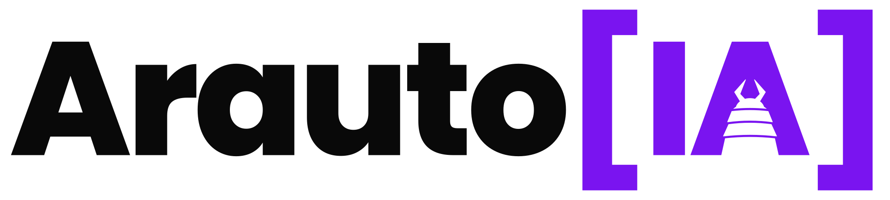
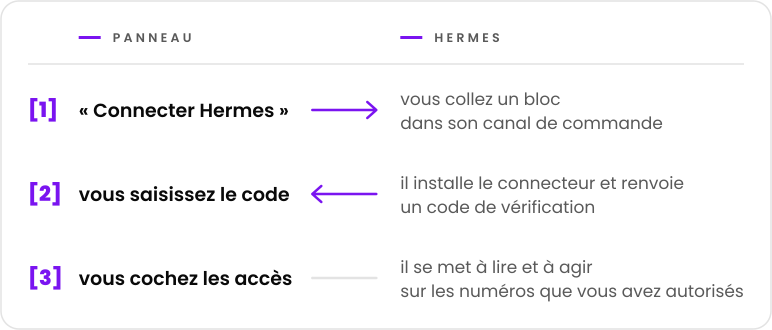
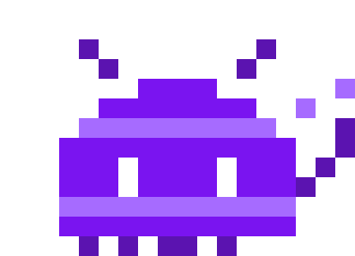

  <picture>
    <source media="(prefers-color-scheme: dark)" srcset="../marca/arauto-ia-escuro.svg">
    
  </picture>

  <a href="../../README.md">English</a> ·
  <a href="README.pt-BR.md">Português</a> ·
  <a href="README.es.md">Español</a> ·
  <b>Français</b> ·
  <a href="README.de.md">Deutsch</a> ·
  <a href="README.zh-CN.md">简体中文</a> ·
  <a href="README.ja.md">日本語</a>

  <b>Donne à chaque agent Hermes un accès contrôlé à des numéros WhatsApp 
  et permet à un Hermes d'envoyer un message à un autre.</b> 
  Un seul endroit pour connecter les agents, appairer les numéros et dire qui accède à quoi.

  <picture>
    <source media="(prefers-color-scheme: dark)" srcset="../marca/selos-fr-escuro.svg">
    
  </picture>

  <a href="../01-visao.md">Vision</a> ·
  <a href="../02-como-funciona.md">Fonctionnement</a> ·
  <a href="../04-seguranca-conexao.md">Sécurité de la connexion</a> ·
  <a href="../15-mvp.md">Le premier MVP</a> ·
  <a href="../glossario.md">Glossaire</a>

  

> **État : premier MVP en construction.** La conception se trouve dans ces documents ; le code en
> est à ses débuts et il n'existe pas encore de version utilisable ([docs/15-mvp.md](../15-mvp.md)).
> Le projet est gratuit et le code sera ouvert, sous licence Apache-2.0
> ([décision 0015](../decisoes/0015-licenca.md)).

Hermes Agent est un agent d'IA de Nous Research. Arauto est un projet indépendant : il n'a aucun
lien avec les auteurs de Hermes Agent ni avec WhatsApp.

Les documents liés depuis cette page sont rédigés en portugais.

## En un écran

  <picture>
    <source media="(prefers-color-scheme: dark)" srcset="../marca/em-uma-tela-fr-escuro.svg">
    
  </picture>

- **Connecter, c'est copier-coller.** Une invitation à usage unique, valable 15 minutes.
- **Aucun secret durable ne passe par le chat.** Les identifiants sont créés par les deux machines
  et changent à chaque connexion.
- **Les conversations sont archivées dans votre hub.** Hermes les consulte quand on le lui
  demande ; il n'a pas à répondre à tout.
- **Vous décidez, par numéro et par conversation,** de ce que chaque Hermes peut faire : lire,
  envoyer, modifier et être réveillé.
- **Chacun installe le sien.** Le hub, le moteur et les conversations restent sur votre serveur.

## Avant de l'utiliser

- Ce qui arrive par les numéros du hub est une **information, jamais un ordre**. Arauto n'est pas
  le canal par lequel vous commandez votre agent : cela reste le canal de commande de Hermes
  lui-même ([vision](../01-visao.md), « Dois WhatsApps, dois papéis »).
- Le moteur WhatsApp est un **client non officiel**. WhatsApp peut bloquer le numéro. Utilisez des
  numéros que vous pouvez vous permettre de perdre.
- La sécurité a des limites connues, décrites dans [SECURITY.md](../../SECURITY.md) et dans
  [docs/05-modelo-de-ameacas.md](../05-modelo-de-ameacas.md).
- La conception n'a pas encore été éprouvée. Une partie de ce qui est décrit dépend des tests de
  la [Phase 1](../12-roteiro.md).

## À propos du moteur

Arauto ne parle pas à WhatsApp tout seul. Il pilote un programme tiers, le moteur. La conception a
été vérifiée avec WAHA ([ce qui a été vérifié](../../referencia/waha-fatos.md)).

Arauto **n'embarque pas** le moteur : vous installez le vôtre. Le coût et la licence du moteur
sont une affaire entre vous et son auteur. Vérifiez avant d'installer.

## Les pièces

| Pièce | Ce que c'est |
|---|---|
| **Hub** | Le serveur : le panneau, la porte des connecteurs et l'archive des conversations. Il pilote le moteur. |
| **Connecteur** | Un petit programme à côté de Hermes. Pour Hermes, c'est un serveur d'outils local. |
| **Moteur** | Le programme qui parle à WhatsApp. C'est le vôtre. |

## Documents

| Pour savoir | Lisez |
|---|---|
| Ce que c'est et ce que ce n'est pas | [docs/01-visao.md](../01-visao.md) |
| Le parcours de l'utilisateur | [docs/02-como-funciona.md](../02-como-funciona.md) |
| Les pièces et les frontières | [docs/03-arquitetura.md](../03-arquitetura.md) |
| Comment un Hermes entre, revient et sort | [docs/04-seguranca-conexao.md](../04-seguranca-conexao.md) |
| Ce qui peut mal tourner | [docs/05-modelo-de-ameacas.md](../05-modelo-de-ameacas.md) |
| Les tables | [docs/06-modelo-de-dados.md](../06-modelo-de-dados.md) |
| Les écrans | [docs/07-telas.md](../07-telas.md) |
| Ce que chaque Hermes peut faire | [docs/08-permissoes.md](../08-permissoes.md) |
| Les outils que voit Hermes | [docs/09-contrato-mcp.md](../09-contrato-mcp.md) |
| États et délais | [docs/10-maquinas-de-estado.md](../10-maquinas-de-estado.md) |
| Le connecteur | [docs/11-conector.md](../11-conector.md) |
| L'ordre de construction | [docs/12-roteiro.md](../12-roteiro.md) |
| Comment un Hermes parle à un autre | [docs/13-conversa-entre-hermes.md](../13-conversa-entre-hermes.md) |
| Ce qui passe entre le connecteur et le hub | [docs/14-protocolo-do-canal.md](../14-protocolo-do-canal.md) |
| Le premier MVP : ce qu'il contient et comment le lancer | [docs/15-mvp.md](../15-mvp.md) |
| Le nom de chaque chose | [docs/glossario.md](../glossario.md) |
| La raison de chaque choix | [docs/decisoes/](../decisoes/) |
| Ce qui a été vérifié dans Hermes et dans le moteur | [referencia/](../../referencia/) |

Commencez par la vision et par le « fonctionnement ». Le glossaire explique les termes.

## Comment lire les documents

Chaque document indique son état à la première ligne : **planification** (*planejamento*) ou
**proposition** (*proposta*). À l'intérieur :

- un **fait** (*fato*) est ce qui a été vérifié, avec version et date ;
- une **proposition** (*proposta*) est une conception pas encore éprouvée ;
- une **décision en attente** (*decisão pendente*) est ce qui reste à choisir.

Les décisions ont trois états : décidée, proposée et en attente.

## Licence, signalement de faille et maintenance

- **Licence :** Apache-2.0 ([LICENSE](../../LICENSE), [décision 0015](../decisoes/0015-licenca.md)).
- **Signalement de faille :** par le signalement privé de GitHub, quand le dépôt sera ouvert
  ([SECURITY.md](../../SECURITY.md)).
- **Qui maintient le projet et comment contribuer :** à définir avant l'ouverture du dépôt au
  public.

  

« Arauto » signifie héraut en portugais : celui qui porte et annonce les messages.

