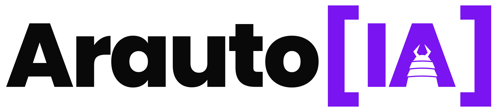
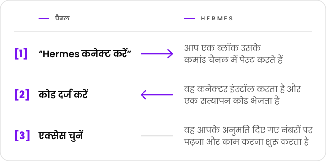
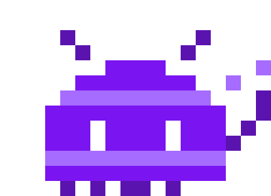

  <picture>
    <source media="(prefers-color-scheme: dark)" srcset="../marca/arauto-ia-escuro.svg">
    
  </picture>

  <a href="../../README.md">English</a> ·
  <a href="README.pt-BR.md">Português</a> ·
  <a href="README.es.md">Español</a> ·
  <a href="README.fr.md">Français</a> ·
  <a href="README.de.md">Deutsch</a> ·
  <a href="README.ru.md">Русский</a> ·
  <b>हिन्दी</b> ·
  <a href="README.zh-CN.md">简体中文</a> ·
  <a href="README.ja.md">日本語</a>

  <b>कई Hermes एजेंट एक टीम की तरह काम करते हैं, 
  और हर एक सिर्फ़ वहीं तक पहुँचता है जहाँ तक उसे पहुँचना चाहिए।</b> 
  एक hub, जहाँ एजेंट कनेक्ट होते हैं, आप तय करते हैं कि कौन किससे बात कर सकता है 
  और हर एजेंट को WhatsApp नंबरों तक उसकी अपनी पहुँच मिलती है।

  <picture>
    <source media="(prefers-color-scheme: dark)" srcset="../marca/selos-hi-escuro.svg">
    
  </picture>

  <a href="../01-visao.md">दृष्टि</a> ·
  <a href="../02-como-funciona.md">यह कैसे काम करता है</a> ·
  <a href="../04-seguranca-conexao.md">कनेक्शन की सुरक्षा</a> ·
  <a href="../15-mvp.md">पहला MVP</a> ·
  <a href="../glossario.md">शब्दावली</a>

  

> **स्थिति: पहला MVP निर्माणाधीन है।** डिज़ाइन इन दस्तावेज़ों में है; कोड अभी शुरू ही हुआ है और
> उपयोग के लायक कोई संस्करण अभी नहीं है ([docs/15-mvp.md](../15-mvp.md))। यह प्रोजेक्ट निःशुल्क है
> और कोड Apache-2.0 लाइसेंस के तहत खुला है ([निर्णय 0015](../decisoes/0015-licenca.md))।

Hermes Agent, Nous Research का एक AI एजेंट है। Arauto एक स्वतंत्र प्रोजेक्ट है: इसका Hermes Agent
के लेखकों या WhatsApp से कोई संबंध नहीं है।

इस पृष्ठ से जुड़े दस्तावेज़ अंग्रेज़ी भाषा में लिखे गए हैं।

## Arauto क्यों

पूरी कंपनी के लिए एक ही एजेंट सब कुछ जानता है, और हो सकता है कि वह किसी को भी कुछ भी बता दे।
किसी भाषा मॉडल से राज़ रखने को कहना एक जोखिम है: देर-सबेर वह एक विभाग का संदर्भ दूसरे विभाग के
जवाब में ले जाता है।

Arauto दूसरे छोर से शुरू करता है: **जहाँ तक एजेंट पहुँच ही नहीं सकता, वहाँ से वह कुछ लीक नहीं कर
सकता।**

- **हर विभाग के लिए एक Hermes, और हर एक की अपनी पहुँच।** बिलिंग देखने वाले एजेंट के पास वह नहीं
  होता जो संपर्कों को जवाब देने वाले एजेंट के पास होता है। हर एक को उसके अपने काम के हिसाब से
  सेट किया जाता है।
- **हर Hermes सिर्फ़ वही रखता है जो उसके काम का है।** हर एक का कॉन्टेक्स्ट पूरा उसके अपने काम के
  लिए बचा रहता है, दूसरे विभागों के मामलों के साथ जगह बाँटे बिना।
- **वे आपस में बात करते हैं, जहाँ आपने इजाज़त दी है।** एक Hermes दूसरे Hermes को hub के ज़रिए
  संदेश भेजता है, सिर्फ़ उस लिंक पर जो आपने बनाया है और सिर्फ़ उस दिशा में जो आपने तय की है।
  जिसे संदेश मिलता है वह खुद तय करता है कि क्या करना है, और सिर्फ़ उतना ही साझा करता है जितना
  ज़रूरी है।
- **एक चैनल, अलग-अलग अधिकार।** एक Hermes किसी WhatsApp नंबर पर जवाब देता है; दूसरा उन्हीं
  बातचीत को सिर्फ़ पढ़ता है, जाँच के लिए, और जवाब नहीं दे सकता।
- **लोग वहीं रहते हैं जहाँ ज़रूरी है।** लक्ष्य एक ऐसी कंपनी है जिसका डिजिटल काम एजेंट करते हैं,
  साफ़ निर्देशों के साथ, और जो बात निर्णायक है उसका फ़ैसला कोई व्यक्ति करता है।

WhatsApp पहला चैनल है, मकसद नहीं। मकसद ऐसे एजेंट हैं जो मिलकर काम करें और उनमें से किसी एक के
पास सब कुछ न हो।

### आगे की दिशा

अभी बनाया नहीं गया है, और विस्तार से डिज़ाइन भी नहीं हुआ है। आज जो मौजूद है वह
[पहले MVP](../15-mvp.md) में है।

- **कंपनी में हर Hermes के लिए एक जगह।** जो अनुरोध नीचे से आता है, उसे ऊपर वाला जोखिम और
  अधिकार की दृष्टि से परखता है; जो निर्देश ऊपर से आता है, उसे निर्देश के रूप में पहचाना जाता है।
  आज एक संदेश के पास कोई अधिकार नहीं होता: वह जानकारी है।
- **जवाब वाले अनुरोध,** और बीच में मंज़ूरी देने वाला एक व्यक्ति, जब एजेंट अकेले फ़ैसला नहीं कर
  सकता।
- **काम एक ही चैनल से नीचे सौंपा जाता है।** जो नेतृत्व करता है वह एक Hermes से बात करता है, और
  वह Hermes काम आगे बाकी Hermes को सौंप देता है।
- **WhatsApp के अलावा और चैनल।**

## एक नज़र में

  <picture>
    <source media="(prefers-color-scheme: dark)" srcset="../marca/em-uma-tela-hi-escuro.svg">
    
  </picture>

- **कनेक्ट करना बस कॉपी करके भेजना है।** एजेंट को एक छोटा संदेश, और बदले में एक सत्यापन कोड।
  एक बार इस्तेमाल होने वाला निमंत्रण, जो 15 मिनट तक मान्य रहता है। (14/11/2026 को दो असली Hermes पर
  आज़माया गया, एक Linux पर और एक Windows पर; कमांड ब्लॉक विकल्प के रूप में रहता है।)
- **कोई भी लंबे समय तक चलने वाला रहस्य चैट से नहीं गुज़रता।** क्रेडेंशियल दोनों मशीनें खुद बनाती
  हैं और वे हर कनेक्शन पर बदल जाते हैं।
- **बातचीत आपके hub में सहेजी जाती है।** Hermes उन्हें तभी देखता है जब उससे कहा जाए; उसे हर बात
  का जवाब देना ज़रूरी नहीं।
- **हर नंबर और हर बातचीत के लिए आप तय करते हैं** कि हर Hermes क्या कर सकता है: पढ़ना, भेजना,
  बदलना और जगाया जाना।
- **हर कोई अपना इंस्टॉल करता है।** Hub, इंजन और बातचीत आपके सर्वर पर ही रहते हैं।

## इस्तेमाल करने से पहले

- Hub के नंबरों से जो आता है वह **जानकारी है, आदेश कभी नहीं**। Arauto वह चैनल नहीं है जिससे आप
  अपने एजेंट को आदेश देते हैं: वह Hermes का अपना कमांड चैनल ही रहता है
  ([दृष्टि](../01-visao.md), “Two WhatsApps, two roles”)।
- जिस चैट में कोई Hermes WhatsApp पर अपने आदेश लेता है, उसमें Hub हर Hermes को लिखने से मना करता है,
  जब आप उस चैट को पैनल में या कमांड से दर्ज कर देते हैं। यह केवल उसी की रक्षा करता है जो आपने दर्ज किया है
  ([निर्णय 0051](../decisoes/0051-quem-da-ordens-a-um-hermes-no-whatsapp.md), एक प्रस्ताव: बनाया गया और नकली इंजन के साथ परखा गया)।
- WhatsApp इंजन एक **अनौपचारिक क्लाइंट** है। WhatsApp नंबर को ब्लॉक कर सकता है। ऐसे नंबर इस्तेमाल
  करें जिन्हें खोना आप सह सकें।
- सुरक्षा की कुछ ज्ञात सीमाएँ हैं, जो [SECURITY.md](../../SECURITY.md) और
  [docs/05-modelo-de-ameacas.md](../05-modelo-de-ameacas.md) में लिखी हैं।
- डिज़ाइन अभी परखा नहीं गया है। जो बताया गया है उसका एक हिस्सा [चरण 1](../12-roteiro.md) के
  परीक्षणों पर निर्भर है।

## इंजन के बारे में

Arauto खुद WhatsApp से बात नहीं करता। वह एक तीसरे पक्ष के प्रोग्राम, यानी इंजन, को चलाता है।
डिज़ाइन की जाँच WAHA के साथ की गई ([क्या जाँचा गया](../../referencia/waha-fatos.md))।

Arauto इंजन को **अपने भीतर नहीं बनाता**: वह किसी तीसरे पक्ष का प्रोग्राम ही रहता है। इंजन की लागत और
लाइसेंस आपके और उसके लेखक के बीच का मामला है। इंस्टॉल करने से पहले जाँच लें।

आप अपना इंजन लाते हैं, या ऐसी विधि का उपयोग करते हैं जो लेखक की मूल इमेज को, तय संस्करण के साथ, Hub के
बगल में एक अलग सेवा के रूप में लाती है ([निर्णय 0052](../decisoes/0052-a-instalacao-traz-o-motor.md), एक प्रस्ताव; आज ऐसी एक विधि है,
[Easypanel](../../deploy/easypanel/README.md) के लिए, जिसे Easypanel पर अभी आज़माया नहीं गया है)।

## हिस्से

| हिस्सा | यह क्या है |
|---|---|
| **Hub** | सर्वर: पैनल, कनेक्टरों का द्वार और बातचीत का संग्रह। यह इंजन को चलाता है। |
| **कनेक्टर** | Hermes के साथ चलने वाला एक छोटा प्रोग्राम। Hermes के लिए यह एक स्थानीय टूल सर्वर है। |
| **इंजन** | वह प्रोग्राम जो WhatsApp से बात करता है। यह किसी तीसरे पक्ष का है: आप इसे लाते हैं, या इंस्टॉलेशन इसे एक अलग सेवा के रूप में लाता है। |

## दस्तावेज़

| जानने के लिए | पढ़ें |
|---|---|
| इसे कैसे इंस्टॉल करें | [deploy/](../../deploy/README.md) |
| यह क्या है और क्या नहीं | [docs/01-visao.md](../01-visao.md) |
| इस्तेमाल करने वाले का रास्ता | [docs/02-como-funciona.md](../02-como-funciona.md) |
| हिस्से और सीमाएँ | [docs/03-arquitetura.md](../03-arquitetura.md) |
| Hermes कैसे जुड़ता, लौटता और निकलता है | [docs/04-seguranca-conexao.md](../04-seguranca-conexao.md) |
| क्या गलत हो सकता है | [docs/05-modelo-de-ameacas.md](../05-modelo-de-ameacas.md) |
| तालिकाएँ | [docs/06-modelo-de-dados.md](../06-modelo-de-dados.md) |
| स्क्रीन | [docs/07-telas.md](../07-telas.md) |
| हर Hermes क्या कर सकता है | [docs/08-permissoes.md](../08-permissoes.md) |
| वे टूल जो Hermes को दिखते हैं | [docs/09-contrato-mcp.md](../09-contrato-mcp.md) |
| स्थितियाँ और समय-सीमाएँ | [docs/10-maquinas-de-estado.md](../10-maquinas-de-estado.md) |
| कनेक्टर | [docs/11-conector.md](../11-conector.md) |
| निर्माण का क्रम | [docs/12-roteiro.md](../12-roteiro.md) |
| एक Hermes दूसरे से कैसे बात करता है | [docs/13-conversa-entre-hermes.md](../13-conversa-entre-hermes.md) |
| कनेक्टर और hub के बीच क्या गुज़रता है | [docs/14-protocolo-do-canal.md](../14-protocolo-do-canal.md) |
| पहला MVP: इसमें क्या है और इसे कैसे चलाएँ | [docs/15-mvp.md](../15-mvp.md) |
| हर चीज़ का नाम | [docs/glossario.md](../glossario.md) |
| हर चुनाव का कारण | [docs/decisoes/](../decisoes/) |
| Hermes और इंजन में क्या जाँचा गया | [referencia/](../../referencia/) |

दृष्टि और “यह कैसे काम करता है” से शुरू करें। शब्दावली शब्दों को समझाती है।

## दस्तावेज़ कैसे पढ़ें

हर दस्तावेज़ पहली पंक्ति में अपनी स्थिति बताता है: **योजना** (*planejamento*) या **प्रस्ताव**
(*proposta*)। उसके अंदर:

- **तथ्य** (*fato*) वह है जो संस्करण और तारीख के साथ जाँचा जा चुका है;
- **प्रस्ताव** (*proposta*) वह डिज़ाइन है जो अभी परखा नहीं गया;
- **लंबित निर्णय** (*decisão pendente*) वह है जिसे अभी चुनना बाकी है।

निर्णयों की तीन स्थितियाँ होती हैं: तय, प्रस्तावित और लंबित।

## लाइसेंस, खामी की सूचना और रखरखाव

- **लाइसेंस:** Apache-2.0 ([LICENSE](../../LICENSE), [निर्णय 0015](../decisoes/0015-licenca.md))।
- **खामी की सूचना:** रिपॉज़िटरी खुलने के बाद, GitHub की निजी रिपोर्टिंग के ज़रिए
  ([SECURITY.md](../../SECURITY.md))।
- **रखरखाव कौन करता है और योगदान कैसे करें:** रिपॉज़िटरी को सार्वजनिक करने से पहले तय किया जाएगा।

## प्रोजेक्ट का समर्थन करें

  

  <picture>
    <source media="(prefers-color-scheme: dark)" srcset="../marca/em-breve-hi-escuro.svg">
    
  </picture>

  Buy Me a Coffee का पेज जल्द आ रहा है। 
  Arauto निःशुल्क है: कॉफ़ी धन्यवाद कहने का एक तरीका होगी, कोई कीमत नहीं।

  

पुर्तगाली में “Arauto” का अर्थ है उद्घोषक: वह जो संदेश ले जाता और सुनाता है।

