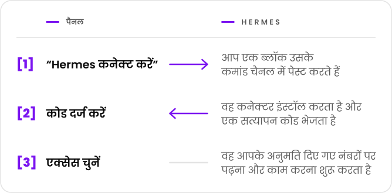

  <picture>
    <source media="(prefers-color-scheme: dark)" srcset="../marca/arauto-ia-escuro.svg">
    
  </picture>

  <a href="../../README.md">English</a> ·
  <a href="README.pt-BR.md">Português</a> ·
  <a href="README.es.md">Español</a> ·
  <a href="README.fr.md">Français</a> ·
  <a href="README.de.md">Deutsch</a> ·
  <a href="README.ru.md">Русский</a> ·
  <b>हिन्दी</b> ·
  <a href="README.zh-CN.md">简体中文</a> ·
  <a href="README.ja.md">日本語</a>

  <b>हर Hermes एजेंट को WhatsApp नंबरों तक नियंत्रित पहुँच देता है 
  और एक Hermes को दूसरे Hermes को संदेश भेजने देता है।</b> 
  एजेंट कनेक्ट करने, नंबर जोड़ने और यह तय करने की एक ही जगह कि किसकी पहुँच किस तक है।

  <picture>
    <source media="(prefers-color-scheme: dark)" srcset="../marca/selos-hi-escuro.svg">
    
  </picture>

  <a href="../01-visao.md">दृष्टि</a> ·
  <a href="../02-como-funciona.md">यह कैसे काम करता है</a> ·
  <a href="../04-seguranca-conexao.md">कनेक्शन की सुरक्षा</a> ·
  <a href="../15-mvp.md">पहला MVP</a> ·
  <a href="../glossario.md">शब्दावली</a>

  

> **स्थिति: पहला MVP निर्माणाधीन है।** डिज़ाइन इन दस्तावेज़ों में है; कोड अभी शुरू ही हुआ है और
> उपयोग के लायक कोई संस्करण अभी नहीं है ([docs/15-mvp.md](../15-mvp.md))। यह प्रोजेक्ट निःशुल्क है
> और कोड Apache-2.0 लाइसेंस के तहत खुला है ([निर्णय 0015](../decisoes/0015-licenca.md))।

Hermes Agent, Nous Research का एक AI एजेंट है। Arauto एक स्वतंत्र प्रोजेक्ट है: इसका Hermes Agent
के लेखकों या WhatsApp से कोई संबंध नहीं है।

इस पृष्ठ से जुड़े दस्तावेज़ अंग्रेज़ी भाषा में लिखे गए हैं।

## एक नज़र में

  <picture>
    <source media="(prefers-color-scheme: dark)" srcset="../marca/em-uma-tela-hi-escuro.svg">
    
  </picture>

- **कनेक्ट करना बस कॉपी करके भेजना है।** (अभी किसी असली Hermes पर आज़माया नहीं गया; कमांड ब्लॉक विकल्प के रूप में रहता है।) एक बार इस्तेमाल होने वाला निमंत्रण, जो 15 मिनट तक मान्य
  रहता है।
- **कोई भी लंबे समय तक चलने वाला रहस्य चैट से नहीं गुज़रता।** क्रेडेंशियल दोनों मशीनें खुद बनाती
  हैं और वे हर कनेक्शन पर बदल जाते हैं।
- **बातचीत आपके hub में सहेजी जाती है।** Hermes उन्हें तभी देखता है जब उससे कहा जाए; उसे हर बात
  का जवाब देना ज़रूरी नहीं।
- **हर नंबर और हर बातचीत के लिए आप तय करते हैं** कि हर Hermes क्या कर सकता है: पढ़ना, भेजना,
  बदलना और जगाया जाना।
- **हर कोई अपना इंस्टॉल करता है।** Hub, इंजन और बातचीत आपके सर्वर पर ही रहते हैं।

## इस्तेमाल करने से पहले

- Hub के नंबरों से जो आता है वह **जानकारी है, आदेश कभी नहीं**। Arauto वह चैनल नहीं है जिससे आप
  अपने एजेंट को आदेश देते हैं: वह Hermes का अपना कमांड चैनल ही रहता है
  ([दृष्टि](../01-visao.md), “Two WhatsApps, two roles”)।
- WhatsApp इंजन एक **अनौपचारिक क्लाइंट** है। WhatsApp नंबर को ब्लॉक कर सकता है। ऐसे नंबर इस्तेमाल
  करें जिन्हें खोना आप सह सकें।
- सुरक्षा की कुछ ज्ञात सीमाएँ हैं, जो [SECURITY.md](../../SECURITY.md) और
  [docs/05-modelo-de-ameacas.md](../05-modelo-de-ameacas.md) में लिखी हैं।
- डिज़ाइन अभी परखा नहीं गया है। जो बताया गया है उसका एक हिस्सा [चरण 1](../12-roteiro.md) के
  परीक्षणों पर निर्भर है।

## इंजन के बारे में

Arauto खुद WhatsApp से बात नहीं करता। वह एक तीसरे पक्ष के प्रोग्राम, यानी इंजन, को चलाता है।
डिज़ाइन की जाँच WAHA के साथ की गई ([क्या जाँचा गया](../../referencia/waha-fatos.md))।

Arauto इंजन को **साथ में शामिल नहीं करता**: आप अपना इंजन इंस्टॉल करते हैं। इंजन की लागत और
लाइसेंस आपके और उसके लेखक के बीच का मामला है। इंस्टॉल करने से पहले जाँच लें।

## हिस्से

| हिस्सा | यह क्या है |
|---|---|
| **Hub** | सर्वर: पैनल, कनेक्टरों का द्वार और बातचीत का संग्रह। यह इंजन को चलाता है। |
| **कनेक्टर** | Hermes के साथ चलने वाला एक छोटा प्रोग्राम। Hermes के लिए यह एक स्थानीय टूल सर्वर है। |
| **इंजन** | वह प्रोग्राम जो WhatsApp से बात करता है। यह आपका है। |

## दस्तावेज़

| जानने के लिए | पढ़ें |
|---|---|
| यह क्या है और क्या नहीं | [docs/01-visao.md](../01-visao.md) |
| इस्तेमाल करने वाले का रास्ता | [docs/02-como-funciona.md](../02-como-funciona.md) |
| हिस्से और सीमाएँ | [docs/03-arquitetura.md](../03-arquitetura.md) |
| Hermes कैसे जुड़ता, लौटता और निकलता है | [docs/04-seguranca-conexao.md](../04-seguranca-conexao.md) |
| क्या गलत हो सकता है | [docs/05-modelo-de-ameacas.md](../05-modelo-de-ameacas.md) |
| तालिकाएँ | [docs/06-modelo-de-dados.md](../06-modelo-de-dados.md) |
| स्क्रीन | [docs/07-telas.md](../07-telas.md) |
| हर Hermes क्या कर सकता है | [docs/08-permissoes.md](../08-permissoes.md) |
| वे टूल जो Hermes को दिखते हैं | [docs/09-contrato-mcp.md](../09-contrato-mcp.md) |
| स्थितियाँ और समय-सीमाएँ | [docs/10-maquinas-de-estado.md](../10-maquinas-de-estado.md) |
| कनेक्टर | [docs/11-conector.md](../11-conector.md) |
| निर्माण का क्रम | [docs/12-roteiro.md](../12-roteiro.md) |
| एक Hermes दूसरे से कैसे बात करता है | [docs/13-conversa-entre-hermes.md](../13-conversa-entre-hermes.md) |
| कनेक्टर और hub के बीच क्या गुज़रता है | [docs/14-protocolo-do-canal.md](../14-protocolo-do-canal.md) |
| पहला MVP: इसमें क्या है और इसे कैसे चलाएँ | [docs/15-mvp.md](../15-mvp.md) |
| हर चीज़ का नाम | [docs/glossario.md](../glossario.md) |
| हर चुनाव का कारण | [docs/decisoes/](../decisoes/) |
| Hermes और इंजन में क्या जाँचा गया | [referencia/](../../referencia/) |

दृष्टि और “यह कैसे काम करता है” से शुरू करें। शब्दावली शब्दों को समझाती है।

## दस्तावेज़ कैसे पढ़ें

हर दस्तावेज़ पहली पंक्ति में अपनी स्थिति बताता है: **योजना** (*planejamento*) या **प्रस्ताव**
(*proposta*)। उसके अंदर:

- **तथ्य** (*fato*) वह है जो संस्करण और तारीख के साथ जाँचा जा चुका है;
- **प्रस्ताव** (*proposta*) वह डिज़ाइन है जो अभी परखा नहीं गया;
- **लंबित निर्णय** (*decisão pendente*) वह है जिसे अभी चुनना बाकी है।

निर्णयों की तीन स्थितियाँ होती हैं: तय, प्रस्तावित और लंबित।

## लाइसेंस, खामी की सूचना और रखरखाव

- **लाइसेंस:** Apache-2.0 ([LICENSE](../../LICENSE), [निर्णय 0015](../decisoes/0015-licenca.md))।
- **खामी की सूचना:** रिपॉज़िटरी खुलने के बाद, GitHub की निजी रिपोर्टिंग के ज़रिए
  ([SECURITY.md](../../SECURITY.md))।
- **रखरखाव कौन करता है और योगदान कैसे करें:** रिपॉज़िटरी को सार्वजनिक करने से पहले तय किया जाएगा।

## प्रोजेक्ट का समर्थन करें

  

  <picture>
    <source media="(prefers-color-scheme: dark)" srcset="../marca/em-breve-hi-escuro.svg">
    
  </picture>

  Buy Me a Coffee का पेज जल्द आ रहा है। 
  Arauto निःशुल्क है: कॉफ़ी धन्यवाद कहने का एक तरीका होगी, कोई कीमत नहीं।

  

पुर्तगाली में “Arauto” का अर्थ है उद्घोषक: वह जो संदेश ले जाता और सुनाता है।

