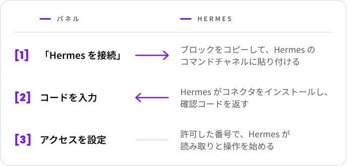

  <picture>
    <source media="(prefers-color-scheme: dark)" srcset="../marca/arauto-ia-escuro.svg">
    
  </picture>

  <a href="../../README.md">English</a> ·
  <a href="README.pt-BR.md">Português</a> ·
  <a href="README.es.md">Español</a> ·
  <a href="README.fr.md">Français</a> ·
  <a href="README.de.md">Deutsch</a> ·
  <a href="README.ru.md">Русский</a> ·
  <a href="README.hi.md">हिन्दी</a> ·
  <a href="README.zh-CN.md">简体中文</a> ·
  <b>日本語</b>

  <b>Hermes エージェントそれぞれに、WhatsApp 番号への管理されたアクセスを与え、 
  Hermes から別の Hermes へメッセージを送れるようにします。</b> 
  エージェントの接続、番号のペアリング、誰が何にアクセスできるかの設定を、ひとつの場所で。

  <picture>
    <source media="(prefers-color-scheme: dark)" srcset="../marca/selos-ja-escuro.svg">
    
  </picture>

  <a href="../01-visao.md">ビジョン</a> ·
  <a href="../02-como-funciona.md">仕組み</a> ·
  <a href="../04-seguranca-conexao.md">接続のセキュリティ</a> ·
  <a href="../15-mvp.md">最初の MVP</a> ·
  <a href="../glossario.md">用語集</a>

  

> **状態：最初の MVP を開発中。** 設計はこれらのドキュメントにあります。コードは書き始めたばかりで、まだ利用できるバージョンはありません（[docs/15-mvp.md](../15-mvp.md)）。このプロジェクトは無料で、コードは Apache-2.0 ライセンスで公開されています（[決定 0015](../decisoes/0015-licenca.md)）。

Hermes Agent は Nous Research の AI エージェントです。Arauto は独立したプロジェクトであり、Hermes Agent の作者とも WhatsApp とも関係はありません。

このページからリンクしているドキュメントは英語で書かれています。

## ひと目でわかる

  <picture>
    <source media="(prefers-color-scheme: dark)" srcset="../marca/em-uma-tela-ja-escuro.svg">
    
  </picture>

- **接続はコピーと貼り付けだけ。** 1 回限りの招待で、有効期間は 15 分です。
- **長く使われる秘密はチャットを通りません。** 認証情報は 2 台のマシンが作成し、接続のたびに入れ替わります。
- **会話はあなたの hub に保管されます。** Hermes は求められたときに参照するだけで、すべてに返信する必要はありません。
- **番号ごと、会話ごとに、あなたが決めます。** 各 Hermes にできること：読む、送る、変更する、起こされる。
- **それぞれが自分の環境にインストールします。** hub、エンジン、会話はあなたのサーバーに置かれます。

## 使う前に知っておくこと

- hub の番号を通じて届くものは**情報であり、命令ではありません**。Arauto はエージェントに指示を出すためのチャネルではありません。指示はこれまでどおり、Hermes 自身のコマンドチャネルで行います（[ビジョン](../01-visao.md)、「Two WhatsApps, two roles」）。
- WhatsApp エンジンは**非公式クライアント**です。WhatsApp が番号をブロックすることがあります。失ってもかまわない番号を使ってください。
- セキュリティには既知の限界があり、[SECURITY.md](../../SECURITY.md) と [docs/05-modelo-de-ameacas.md](../05-modelo-de-ameacas.md) に書かれています。
- 設計はまだ実証されていません。記述の一部は[フェーズ 1](../12-roteiro.md) のテストにかかっています。

## エンジンについて

Arauto は単独では WhatsApp と通信しません。サードパーティのプログラムであるエンジンを操作します。設計は WAHA で確認しました（[確認した内容](../../referencia/waha-fatos.md)）。

Arauto はエンジンを**同梱しません**。エンジンは各自でインストールします。エンジンの費用とライセンスは、あなたとその作者との間の問題です。インストールする前に確認してください。

## 構成要素

| 要素 | 役割 |
|---|---|
| **Hub** | サーバー：パネル、コネクタの入口、会話のアーカイブ。エンジンを操作します。 |
| **コネクタ** | Hermes の隣で動く小さなプログラム。Hermes から見ると、ローカルのツールサーバーです。 |
| **エンジン** | WhatsApp と通信するプログラム。あなた自身のものです。 |

## ドキュメント

| 知りたいこと | 読むもの |
|---|---|
| 何であり、何でないか | [docs/01-visao.md](../01-visao.md) |
| 利用者がたどる流れ | [docs/02-como-funciona.md](../02-como-funciona.md) |
| 構成要素と境界 | [docs/03-arquitetura.md](../03-arquitetura.md) |
| Hermes が参加し、戻り、離れる方法 | [docs/04-seguranca-conexao.md](../04-seguranca-conexao.md) |
| 起こりうる問題 | [docs/05-modelo-de-ameacas.md](../05-modelo-de-ameacas.md) |
| テーブル | [docs/06-modelo-de-dados.md](../06-modelo-de-dados.md) |
| 画面 | [docs/07-telas.md](../07-telas.md) |
| 各 Hermes にできること | [docs/08-permissoes.md](../08-permissoes.md) |
| Hermes から見えるツール | [docs/09-contrato-mcp.md](../09-contrato-mcp.md) |
| 状態と期限 | [docs/10-maquinas-de-estado.md](../10-maquinas-de-estado.md) |
| コネクタ | [docs/11-conector.md](../11-conector.md) |
| 構築の順序 | [docs/12-roteiro.md](../12-roteiro.md) |
| Hermes 同士の会話の方法 | [docs/13-conversa-entre-hermes.md](../13-conversa-entre-hermes.md) |
| コネクタと hub の間を流れるもの | [docs/14-protocolo-do-canal.md](../14-protocolo-do-canal.md) |
| 最初の MVP：含まれるものと実行方法 | [docs/15-mvp.md](../15-mvp.md) |
| それぞれの名前 | [docs/glossario.md](../glossario.md) |
| それぞれの選択の理由 | [docs/decisoes/](../decisoes/) |
| Hermes とエンジンで確認したこと | [referencia/](../../referencia/) |

まずビジョンと「仕組み」から読んでください。用語は用語集で説明しています。

## ドキュメントの読み方

各ドキュメントは 1 行目で自分の状態を示します：**計画**（*planejamento*）または**提案** （*proposta*）。本文では：

- **事実**（*fato*）は、バージョンと日付を添えて確認済みのもの。
- **提案**（*proposta*）は、まだ実証されていない設計。
- **保留中の決定**（*decisão pendente*）は、これから選ぶ必要があるもの。

決定には 3 つの状態があります：決定済み、提案中、保留中。

## ライセンス、脆弱性の報告、メンテナー

- **ライセンス：** Apache-2.0（[LICENSE](../../LICENSE)、[決定 0015](../decisoes/0015-licenca.md)）。
- **脆弱性の報告：** リポジトリの公開後、GitHub の非公開報告機能で受け付けます（[SECURITY.md](../../SECURITY.md)）。
- **メンテナーと貢献の方法：** リポジトリを一般公開する前に決めます。

## プロジェクトを支援する

  

  <picture>
    <source media="(prefers-color-scheme: dark)" srcset="../marca/em-breve-ja-escuro.svg">
    
  </picture>

  Buy Me a Coffee のページを準備中です。 
  Arauto は無料です。コーヒーは感謝を伝える手段であり、対価ではありません。

  

「Arauto」はポルトガル語で伝令のこと。メッセージを運び、告げる者です。

