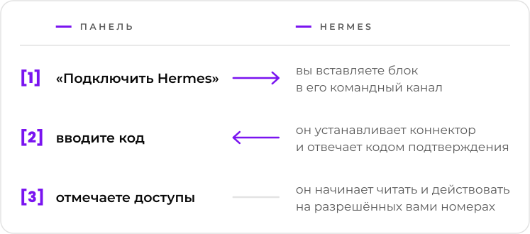

  <picture>
    <source media="(prefers-color-scheme: dark)" srcset="../marca/arauto-ia-escuro.svg">
    
  </picture>

  <a href="../../README.md">English</a> ·
  <a href="README.pt-BR.md">Português</a> ·
  <a href="README.es.md">Español</a> ·
  <a href="README.fr.md">Français</a> ·
  <a href="README.de.md">Deutsch</a> ·
  <b>Русский</b> ·
  <a href="README.hi.md">हिन्दी</a> ·
  <a href="README.zh-CN.md">简体中文</a> ·
  <a href="README.ja.md">日本語</a>

  <b>Даёт каждому агенту Hermes контролируемый доступ к номерам WhatsApp 
  и позволяет одному Hermes отправить сообщение другому.</b> 
  Одно место, чтобы подключать агентов, привязывать номера и решать, кто к чему имеет доступ.

  <picture>
    <source media="(prefers-color-scheme: dark)" srcset="../marca/selos-ru-escuro.svg">
    
  </picture>

  <a href="../01-visao.md">Замысел</a> ·
  <a href="../02-como-funciona.md">Как это работает</a> ·
  <a href="../04-seguranca-conexao.md">Безопасность подключения</a> ·
  <a href="../15-mvp.md">Первый MVP</a> ·
  <a href="../glossario.md">Глоссарий</a>

  

> **Состояние: первый MVP в разработке.** Проект описан в этих документах; код только начат, и
> пригодной для использования версии пока нет ([docs/15-mvp.md](../15-mvp.md)). Проект бесплатный,
> а код открыт под лицензией Apache-2.0 ([решение 0015](../decisoes/0015-licenca.md)).

Hermes Agent — это ИИ-агент от Nous Research. Arauto — независимый проект: он не связан ни с
авторами Hermes Agent, ни с WhatsApp.

Документы, на которые ведут ссылки с этой страницы, написаны на английском языке.

## На одном экране

  <picture>
    <source media="(prefers-color-scheme: dark)" srcset="../marca/em-uma-tela-ru-escuro.svg">
    
  </picture>

- **Подключить — значит скопировать и отправить.** (Пока не проверено на настоящем Hermes; блок команд остаётся запасным вариантом.) Одноразовое приглашение, действует 15 минут.
- **Ни один долгоживущий секрет не проходит через чат.** Учётные данные создаются двумя машинами
  и меняются при каждом подключении.
- **Переписка архивируется в вашем хабе.** Hermes обращается к ней, когда его просят; отвечать на
  всё он не обязан.
- **Вы решаете, по каждому номеру и каждому чату,** что может каждый Hermes: читать, отправлять,
  изменять и быть разбуженным.
- **Каждый ставит своё.** Хаб, движок и переписка остаются на вашем сервере.

## Прежде чем использовать

- То, что приходит через номера хаба, — это **информация, а не приказ**. Arauto — не тот канал,
  по которому вы командуете своим агентом: им остаётся собственный командный канал Hermes
  ([замысел](../01-visao.md), «Two WhatsApps, two roles»).
- Движок WhatsApp — **неофициальный клиент**. WhatsApp может заблокировать номер. Используйте
  номера, которые не жалко потерять.
- У безопасности есть известные пределы, описанные в [SECURITY.md](../../SECURITY.md) и в
  [docs/05-modelo-de-ameacas.md](../05-modelo-de-ameacas.md).
- Проект ещё не проверен на практике. Часть описанного зависит от тестов
  [Фазы 1](../12-roteiro.md).

## О движке

Arauto не общается с WhatsApp сам. Он управляет сторонней программой — движком. Проект сверен с
WAHA ([что было проверено](../../referencia/waha-fatos.md)).

Arauto **не включает** движок в поставку: вы устанавливаете свой. Стоимость и лицензия движка —
вопрос между вами и его автором. Проверьте перед установкой.

## Части

| Часть | Что это |
|---|---|
| **Хаб** | Сервер: панель, вход для коннекторов, архив переписки. Управляет движком. |
| **Коннектор** | Небольшая программа рядом с Hermes. Для Hermes это локальный сервер инструментов. |
| **Движок** | Программа, которая общается с WhatsApp. Он ваш. |

## Документы

| Чтобы узнать | Читайте |
|---|---|
| Что это такое и чем оно не является | [docs/01-visao.md](../01-visao.md) |
| Путь пользователя | [docs/02-como-funciona.md](../02-como-funciona.md) |
| Части и границы | [docs/03-arquitetura.md](../03-arquitetura.md) |
| Как Hermes входит, возвращается и выходит | [docs/04-seguranca-conexao.md](../04-seguranca-conexao.md) |
| Что может пойти не так | [docs/05-modelo-de-ameacas.md](../05-modelo-de-ameacas.md) |
| Таблицы | [docs/06-modelo-de-dados.md](../06-modelo-de-dados.md) |
| Экраны | [docs/07-telas.md](../07-telas.md) |
| Что может каждый Hermes | [docs/08-permissoes.md](../08-permissoes.md) |
| Инструменты, которые видит Hermes | [docs/09-contrato-mcp.md](../09-contrato-mcp.md) |
| Состояния и сроки | [docs/10-maquinas-de-estado.md](../10-maquinas-de-estado.md) |
| Коннектор | [docs/11-conector.md](../11-conector.md) |
| Порядок разработки | [docs/12-roteiro.md](../12-roteiro.md) |
| Как один Hermes говорит с другим | [docs/13-conversa-entre-hermes.md](../13-conversa-entre-hermes.md) |
| Что проходит между коннектором и хабом | [docs/14-protocolo-do-canal.md](../14-protocolo-do-canal.md) |
| Первый MVP: что в него входит и как его запустить | [docs/15-mvp.md](../15-mvp.md) |
| Название каждой вещи | [docs/glossario.md](../glossario.md) |
| Причина каждого выбора | [docs/decisoes/](../decisoes/) |
| Что было проверено в Hermes и в движке | [referencia/](../../referencia/) |

Начните с замысла и с «как это работает». Термины объясняет глоссарий.

## Как читать документы

Каждый документ указывает своё состояние в первой строке: **планирование** (*planejamento*) или
**предложение** (*proposta*). Внутри него:

- **факт** (*fato*) — то, что проверено, с версией и датой;
- **предложение** (*proposta*) — замысел, ещё не проверенный на практике;
- **отложенное решение** (*decisão pendente*) — то, что ещё предстоит выбрать.

У решений три состояния: принято, предложено и отложено.

## Лицензия, сообщения об уязвимостях и сопровождение

- **Лицензия:** Apache-2.0 ([LICENSE](../../LICENSE), [решение 0015](../decisoes/0015-licenca.md)).
- **Сообщения об уязвимостях:** через приватные сообщения GitHub, когда репозиторий будет открыт
  ([SECURITY.md](../../SECURITY.md)).
- **Кто сопровождает проект и как в нём участвовать:** будет определено до открытия репозитория
  для всех.

## Поддержать проект

  

  <picture>
    <source media="(prefers-color-scheme: dark)" srcset="../marca/em-breve-ru-escuro.svg">
    
  </picture>

  Страница на Buy Me a Coffee скоро появится. 
  Arauto бесплатен: кофе будет способом сказать спасибо, а не ценой.

  

«Arauto» по-португальски значит «глашатай»: тот, кто несёт и объявляет вести.

