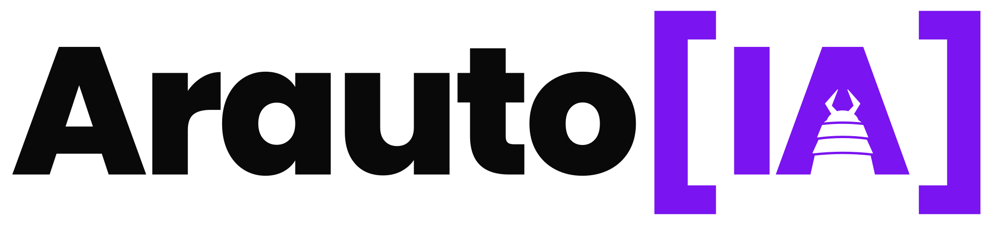
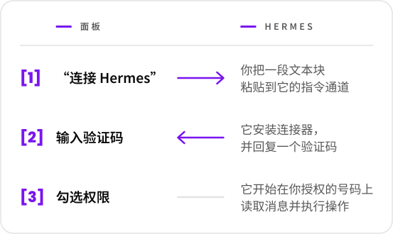
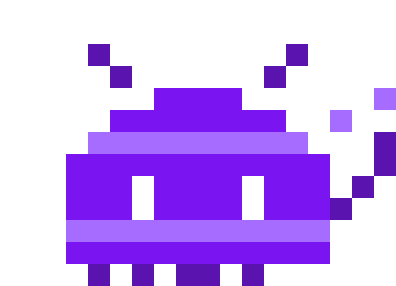

  <picture>
    <source media="(prefers-color-scheme: dark)" srcset="../marca/arauto-ia-escuro.svg">
    
  </picture>

  <a href="../../README.md">English</a> ·
  <a href="README.pt-BR.md">Português</a> ·
  <a href="README.es.md">Español</a> ·
  <a href="README.fr.md">Français</a> ·
  <a href="README.de.md">Deutsch</a> ·
  <a href="README.ru.md">Русский</a> ·
  <a href="README.hi.md">हिन्दी</a> ·
  <b>简体中文</b> ·
  <a href="README.ja.md">日本語</a>

  <b>许多 Hermes 智能体像一个团队那样协作， 
  每一个只触及它该触及的内容。</b> 
  用一个 hub 连接智能体，决定谁可以和谁对话， 
  并为每一个智能体分配它自己的 WhatsApp 号码访问权限。

  <picture>
    <source media="(prefers-color-scheme: dark)" srcset="../marca/selos-zh-CN-escuro.svg">
    
  </picture>

  <a href="../01-visao.md">愿景</a> ·
  <a href="../02-como-funciona.md">工作原理</a> ·
  <a href="../04-seguranca-conexao.md">连接安全</a> ·
  <a href="../15-mvp.md">第一个 MVP</a> ·
  <a href="../glossario.md">术语表</a>

  

> **状态：第一个 MVP 正在开发中。** 设计写在这些文档里；代码刚刚起步，目前还没有可用的版本（[docs/15-mvp.md](../15-mvp.md)）。本项目免费，代码以 Apache-2.0 许可证开源（[决定 0015](../decisoes/0015-licenca.md)）。

Hermes Agent 是 Nous Research 的 AI 智能体。Arauto 是一个独立项目：与 Hermes Agent 的作者以及 WhatsApp 均无关联。

本页链接的文档均以英语撰写。

## 为什么是 Arauto

整个公司只用一个智能体，它什么都知道，也就可能把任何事告诉任何人。
让语言模型替你保守秘密是一种风险：迟早，它会把一个部门的上下文带进给另一个部门的回答里。

Arauto 从另一端出发：**智能体够不到的东西，它就泄露不了。**

- **每个部门一个 Hermes，各有各的访问权限。** 负责账单的智能体，不持有负责答复联系人的智能体所持有的东西。
  每一个都按自己的工作来配置。
- **每个 Hermes 只保留属于自己工作的内容。** 每一个的上下文都完整留给自己的职责，
  不必和其他部门的事务挤占空间。
- **它们在你允许的范围内互相交流。** 一个 Hermes 通过 hub 给另一个 Hermes 发消息，
  只能走你创建的链接，只能朝你指定的方向。接收的一方自行判断该怎么做，并且只分享必要的部分。
- **同一个渠道，不同的权利。** 一个 Hermes 在某个 WhatsApp 号码上答复；
  另一个只读取同样的对话，用于审计，不能回复。
- **人留在关键的地方。** 目标是这样一家公司：数字化的工作由智能体完成，
  有清晰的准则，由人来决定哪些事至关重要。

WhatsApp 是第一个渠道，而不是重点。重点是能协同工作的智能体，而且其中没有哪一个掌握一切。

### 接下来的方向

尚未构建，也还没有详细设计。目前已有的内容在[第一个 MVP](../15-mvp.md) 中。

- **每个 Hermes 在公司里都有自己的位置。** 自下而上的请求，由上一级从风险和授权两方面来判断；
  自上而下的指令，会被识别为指令。目前，一条消息不具有任何指令效力：它只是信息。
- **有答复的请求，** 以及在智能体无法独自决定时，由一个人在中途批准。
- **工作通过同一个渠道向下交办。** 负责人和一个 Hermes 对话，由它把工作转交给其他 Hermes。
- **在 WhatsApp 之外的更多渠道。**

## 一图看懂

  <picture>
    <source media="(prefers-color-scheme: dark)" srcset="../marca/em-uma-tela-zh-CN-escuro.svg">
    
  </picture>

- **连接就是复制并发送。** 给智能体发一条简短的消息，然后收到一个验证码。
  一次性邀请，有效期 15 分钟。（已于 14/11/2026 在两个真实的 Hermes 上试过，一个在 Linux 上，
  一个在 Windows 上；命令块仍作为备用方案。）
- **任何长期有效的密钥都不会经过聊天。** 凭据由两台机器自行生成，并在每次连接时更换。
- **对话归档在你的 hub 中。** Hermes 在被要求时才去查阅，不必回复每一条消息。
- **由你决定，按号码、按对话，** 每个 Hermes 可以做什么：读取、发送、修改和被唤醒。
- **各自安装各自的。** hub、引擎和对话都留在你的服务器上。

## 使用前须知

- 通过 hub 的号码收到的内容是**信息，绝不是命令**。Arauto 不是你指挥智能体的通道：指挥仍然走 Hermes 自己的指令通道（[愿景](../01-visao.md)，“Two WhatsApps, two roles”）。
- 当你在面板中或通过命令登记了某个 Hermes 在 WhatsApp 上接收命令的对话后，hub 会拒绝任何 Hermes 在该对话中写入。它只保护你登记过的内容（[决定 0051](../decisoes/0051-quem-da-ordens-a-um-hermes-no-whatsapp.md)，一项提议：已实现，并针对模拟引擎测试过）。
- WhatsApp 引擎是**非官方客户端**。WhatsApp 可能封禁号码。请使用你承受得起丢失的号码。
- 安全性有已知的限制，写在 [SECURITY.md](../../SECURITY.md) 和 [docs/05-modelo-de-ameacas.md](../05-modelo-de-ameacas.md) 中。
- 设计尚未得到验证。其中一部分内容取决于[第 1 阶段](../12-roteiro.md)的测试。

## 关于引擎

Arauto 自己并不与 WhatsApp 通信。它驱动一个第三方程序，即引擎。设计已对照 WAHA 核对过（[核对了什么](../../referencia/waha-fatos.md)）。

Arauto **不把引擎做进自身**：引擎仍然是第三方程序。引擎的费用和许可证由你与其作者之间解决。安装前请先确认。

你可以自带引擎，也可以使用一份配方：它把作者的原始镜像（固定版本）作为 hub 旁边的一个独立服务带进来（[决定 0052](../decisoes/0052-a-instalacao-traz-o-motor.md)，一项提议；目前有一份这样的配方，用于 [Easypanel](../../deploy/easypanel/README.md)）。

## 组成部分

| 部分 | 是什么 |
|---|---|
| **Hub** | 服务器：面板、连接器的入口、对话归档。它驱动引擎。 |
| **连接器** | 运行在 Hermes 旁边的小程序。对 Hermes 来说，它是一个本地工具服务器。 |
| **引擎** | 与 WhatsApp 通信的程序。它属于第三方：你自带，或由安装把它作为独立服务带进来。 |

## 文档

| 想了解 | 请阅读 |
|---|---|
| 如何安装 | [deploy/](../../deploy/README.md) |
| 它是什么、不是什么 | [docs/01-visao.md](../01-visao.md) |
| 使用者的操作路径 | [docs/02-como-funciona.md](../02-como-funciona.md) |
| 各个部分与边界 | [docs/03-arquitetura.md](../03-arquitetura.md) |
| Hermes 如何加入、返回和退出 | [docs/04-seguranca-conexao.md](../04-seguranca-conexao.md) |
| 可能出什么问题 | [docs/05-modelo-de-ameacas.md](../05-modelo-de-ameacas.md) |
| 数据表 | [docs/06-modelo-de-dados.md](../06-modelo-de-dados.md) |
| 界面 | [docs/07-telas.md](../07-telas.md) |
| 每个 Hermes 可以做什么 | [docs/08-permissoes.md](../08-permissoes.md) |
| Hermes 能看到的工具 | [docs/09-contrato-mcp.md](../09-contrato-mcp.md) |
| 状态与期限 | [docs/10-maquinas-de-estado.md](../10-maquinas-de-estado.md) |
| 连接器 | [docs/11-conector.md](../11-conector.md) |
| 构建顺序 | [docs/12-roteiro.md](../12-roteiro.md) |
| 一个 Hermes 如何与另一个对话 | [docs/13-conversa-entre-hermes.md](../13-conversa-entre-hermes.md) |
| 连接器与 hub 之间传递什么 | [docs/14-protocolo-do-canal.md](../14-protocolo-do-canal.md) |
| 第一个 MVP：包含什么、如何运行 | [docs/15-mvp.md](../15-mvp.md) |
| 每样东西的名称 | [docs/glossario.md](../glossario.md) |
| 每个选择的理由 | [docs/decisoes/](../decisoes/) |
| 在 Hermes 和引擎上核对过什么 | [referencia/](../../referencia/) |

请从愿景和“工作原理”开始。术语表解释各个术语。

## 如何阅读文档

每份文档在第一行说明自己的状态：**规划**（*planejamento*）或**提案**（*proposta*）。文档中：

- **事实**（*fato*）是已经核对过的内容，附有版本和日期；
- **提案**（*proposta*）是尚未验证的设计；
- **待定决定**（*decisão pendente*）是还需要做出选择的事项。

决定有三种状态：已决定、提议中和待定。

## 许可证、漏洞报告与维护者

- **许可证：** Apache-2.0（[LICENSE](../../LICENSE)，[决定 0015](../decisoes/0015-licenca.md)）。
- **漏洞报告：** 仓库公开后，通过 GitHub 的私密报告功能提交（[SECURITY.md](../../SECURITY.md)）。
- **维护者与贡献方式：** 将在仓库向公众开放之前确定。

## 支持本项目

  

  <picture>
    <source media="(prefers-color-scheme: dark)" srcset="../marca/em-breve-zh-CN-escuro.svg">
    
  </picture>

  Buy Me a Coffee 页面正在准备中。 
  Arauto 是免费的：请喝一杯咖啡只是表达感谢的方式，而不是价格。

  

“Arauto”在葡萄牙语中意为传令官：传递并宣告消息的人。

