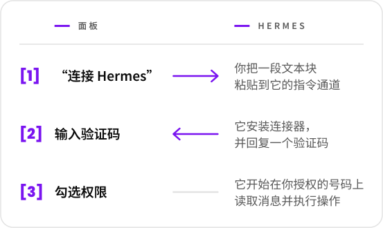

  <picture>
    <source media="(prefers-color-scheme: dark)" srcset="../marca/arauto-ia-escuro.svg">
    
  </picture>

  <a href="../../README.md">English</a> ·
  <a href="README.pt-BR.md">Português</a> ·
  <a href="README.es.md">Español</a> ·
  <a href="README.fr.md">Français</a> ·
  <a href="README.de.md">Deutsch</a> ·
  <b>简体中文</b> ·
  <a href="README.ja.md">日本語</a>

  <b>让每个 Hermes 智能体以受控的方式访问 WhatsApp 号码， 
  并让一个 Hermes 给另一个 Hermes 发消息。</b> 
  在同一个地方连接智能体、配对号码，并决定谁可以访问什么。

  <picture>
    <source media="(prefers-color-scheme: dark)" srcset="../marca/selos-zh-CN-escuro.svg">
    
  </picture>

  <a href="../01-visao.md">愿景</a> ·
  <a href="../02-como-funciona.md">工作原理</a> ·
  <a href="../04-seguranca-conexao.md">连接安全</a> ·
  <a href="../15-mvp.md">第一个 MVP</a> ·
  <a href="../glossario.md">术语表</a>

> **状态：第一个 MVP 正在开发中。** 设计写在这些文档里；代码刚刚起步，目前还没有可用的版本（[docs/15-mvp.md](../15-mvp.md)）。本项目免费，代码将以 Apache-2.0 许可证开源（[决定 0015](../decisoes/0015-licenca.md)）。

Hermes Agent 是 Nous Research 的 AI 智能体。Arauto 是一个独立项目：与 Hermes Agent 的作者以及 WhatsApp 均无关联。

本页链接的文档均以葡萄牙语撰写。

## 一图看懂

  <picture>
    <source media="(prefers-color-scheme: dark)" srcset="../marca/em-uma-tela-zh-CN-escuro.svg">
    
  </picture>

- **连接就是复制和粘贴。** 一次性邀请，有效期 15 分钟。
- **任何长期有效的密钥都不会经过聊天。** 凭据由两台机器自行生成，并在每次连接时更换。
- **对话归档在你的 hub 中。** Hermes 在被要求时才去查阅，不必回复每一条消息。
- **由你决定，按号码、按对话，** 每个 Hermes 可以做什么：读取、发送、修改和被唤醒。
- **各自安装各自的。** hub、引擎和对话都留在你的服务器上。

## 使用前须知

- 通过 hub 的号码收到的内容是**信息，绝不是命令**。Arauto 不是你指挥智能体的通道：指挥仍然走 Hermes 自己的指令通道（[愿景](../01-visao.md)，“Dois WhatsApps, dois papéis”）。
- WhatsApp 引擎是**非官方客户端**。WhatsApp 可能封禁号码。请使用你承受得起丢失的号码。
- 安全性有已知的限制，写在 [SECURITY.md](../../SECURITY.md) 和 [docs/05-modelo-de-ameacas.md](../05-modelo-de-ameacas.md) 中。
- 设计尚未得到验证。其中一部分内容取决于[第 1 阶段](../12-roteiro.md)的测试。

## 关于引擎

Arauto 自己并不与 WhatsApp 通信。它驱动一个第三方程序，即引擎。设计已对照 WAHA 核对过（[核对了什么](../../referencia/waha-fatos.md)）。

Arauto **不内置**引擎：你需要安装自己的引擎。引擎的费用和许可证由你与其作者之间解决。安装前请先确认。

## 组成部分

| 部分 | 是什么 |
|---|---|
| **Hub** | 服务器：面板、连接器的入口、对话归档。它驱动引擎。 |
| **连接器** | 运行在 Hermes 旁边的小程序。对 Hermes 来说，它是一个本地工具服务器。 |
| **引擎** | 与 WhatsApp 通信的程序。它是你自己的。 |

## 文档

| 想了解 | 请阅读 |
|---|---|
| 它是什么、不是什么 | [docs/01-visao.md](../01-visao.md) |
| 使用者的操作路径 | [docs/02-como-funciona.md](../02-como-funciona.md) |
| 各个部分与边界 | [docs/03-arquitetura.md](../03-arquitetura.md) |
| Hermes 如何加入、返回和退出 | [docs/04-seguranca-conexao.md](../04-seguranca-conexao.md) |
| 可能出什么问题 | [docs/05-modelo-de-ameacas.md](../05-modelo-de-ameacas.md) |
| 数据表 | [docs/06-modelo-de-dados.md](../06-modelo-de-dados.md) |
| 界面 | [docs/07-telas.md](../07-telas.md) |
| 每个 Hermes 可以做什么 | [docs/08-permissoes.md](../08-permissoes.md) |
| Hermes 能看到的工具 | [docs/09-contrato-mcp.md](../09-contrato-mcp.md) |
| 状态与期限 | [docs/10-maquinas-de-estado.md](../10-maquinas-de-estado.md) |
| 连接器 | [docs/11-conector.md](../11-conector.md) |
| 构建顺序 | [docs/12-roteiro.md](../12-roteiro.md) |
| 一个 Hermes 如何与另一个对话 | [docs/13-conversa-entre-hermes.md](../13-conversa-entre-hermes.md) |
| 连接器与 hub 之间传递什么 | [docs/14-protocolo-do-canal.md](../14-protocolo-do-canal.md) |
| 第一个 MVP：包含什么、如何运行 | [docs/15-mvp.md](../15-mvp.md) |
| 每样东西的名称 | [docs/glossario.md](../glossario.md) |
| 每个选择的理由 | [docs/decisoes/](../decisoes/) |
| 在 Hermes 和引擎上核对过什么 | [referencia/](../../referencia/) |

请从愿景和“工作原理”开始。术语表解释各个术语。

## 如何阅读文档

每份文档在第一行说明自己的状态：**规划**（*planejamento*）或**提案**（*proposta*）。文档中：

- **事实**（*fato*）是已经核对过的内容，附有版本和日期；
- **提案**（*proposta*）是尚未验证的设计；
- **待定决定**（*decisão pendente*）是还需要做出选择的事项。

决定有三种状态：已决定、提议中和待定。

## 许可证、漏洞报告与维护者

- **许可证：** Apache-2.0（[LICENSE](../../LICENSE)，[决定 0015](../decisoes/0015-licenca.md)）。
- **漏洞报告：** 仓库公开后，通过 GitHub 的私密报告功能提交（[SECURITY.md](../../SECURITY.md)）。
- **维护者与贡献方式：** 将在仓库向公众开放之前确定。

  

“Arauto”在葡萄牙语中意为传令官：传递并宣告消息的人。

